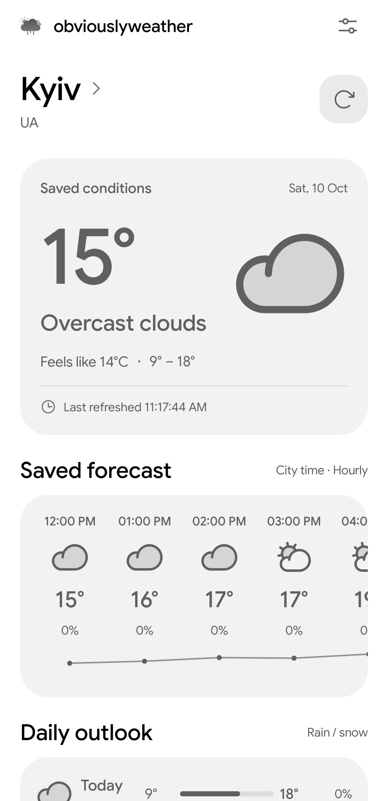
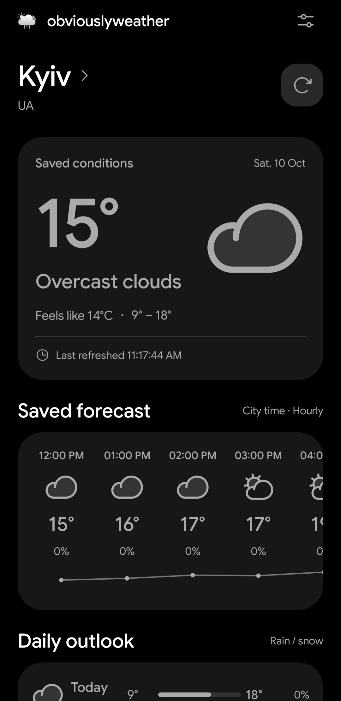
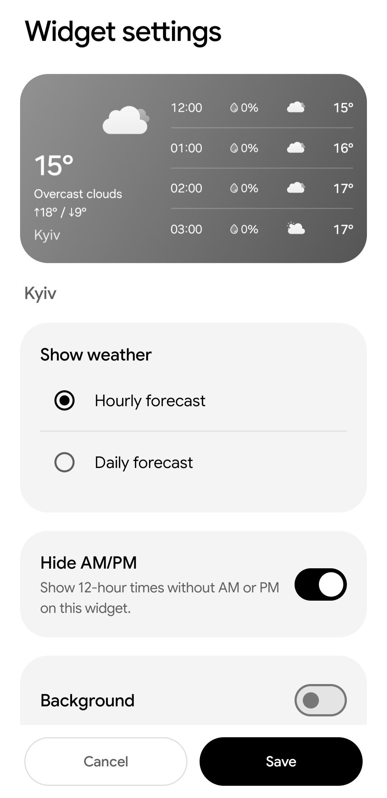
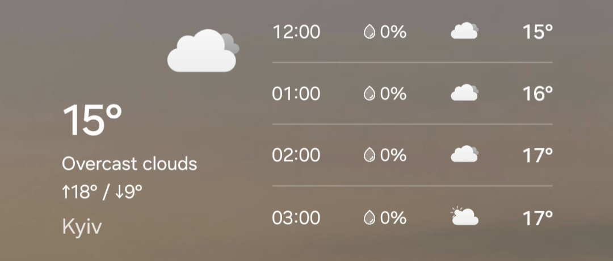
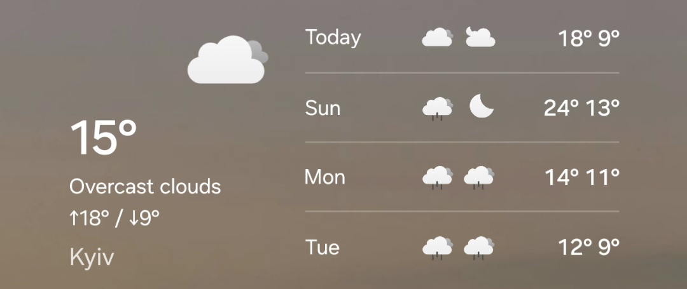

# obviouslyweather

An open-source weather app for Android with a black-and-white interface, home-screen widget and rain alerts. Requires an ARM64 device with at least Android 15 installed.

**[Download the APK](https://github.com/obviouslyvoid/obviouslyweather/releases)**

## Features

- Current conditions, hourly forecasts and a daily outlook.
- Hourly and daily widget with gray and white backgrounds and a black or white text (both background and text color are changeable).
- Rain notifications for upcoming rain, estimated ending times and changes to the forecast. Quiet hours are optional.
- Light and dark themes, with an option to follow the device theme.
- Custom fonts can be imported and used for widgets.

## Screenshots

| Light theme | Dark theme | Widget settings |
| :---: | :---: | :---: |
| [](docs/screenshots/1screenshot_homescreen_light.jpg) | [](docs/screenshots/2screenshot_homescreen_dark.jpg) | [](docs/screenshots/3screenshot_widget_settings.jpg) |

| Hourly widget | Daily widget |
| :---: | :---: |
| [](docs/screenshots/4screenshot_widget_hourly_fc.jpg) | [](docs/screenshots/5screenshot_widget_daily_fc.jpg) |

## Setup

Install the APK, enter your [OpenWeather API key](https://home.openweathermap.org/api_keys), and choose a city. One Call API 3.0 & One Call API 4.0 need manual set up, more info: [One Call API 4.0](https://openweathermap.org/api/one-call-4?collection=one_call_api). Remember: One Call API 4.0 is preferred and One Call API 3.0 is deprecated by OpenWeather, but we still support it for people who prefer it to use it.

Hourly forecasts need One Call API 4.0 access. Daily forecasts can use One Call 4.0 or 3.0; you choose which one in settings.

The app has no ads or analytics. Weather requests go directly to OpenWeather. See [Privacy](PRIVACY.md) for details.

## Building

Open the project in Android Studio and let Gradle sync. You can build there or use the Gradle wrapper:

```sh
./gradlew :app:assembleDebug
```

On Windows, run `gradlew.bat :app:assembleDebug`. The debug APK is in `app/build/outputs/apk/debug/`.

## Contributing

Use [Issues](https://github.com/obviouslyvoid/obviouslyweather/issues) for bug reports and feature requests. For code changes, see [Contributing](CONTRIBUTING.md). Report vulnerabilities through [Security](SECURITY.md).

## To-Do list (things from here will be updated and also removed)

-- Add custom background colors to the widget.
-- Add adjustable text colors (beside black and white) to widgets.
-- Add more widgets.
-- Add custom font imports for the app itself (not just the widgets).
-- Add other measurement units for pressure and everything else (so the user can set custom ones instead of the defaults).
-- Add other languages.

## License

[GPL-3.0-or-later](LICENSE). Fonts, icons and dependencies have their own licenses, listed in [Third-party notices](THIRD_PARTY_NOTICES.md).
